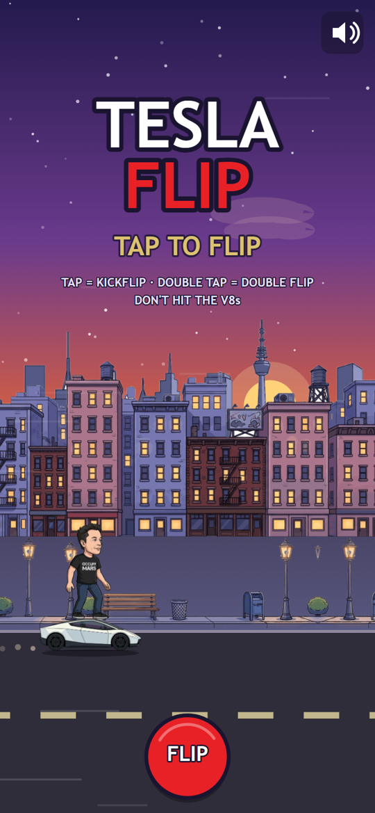
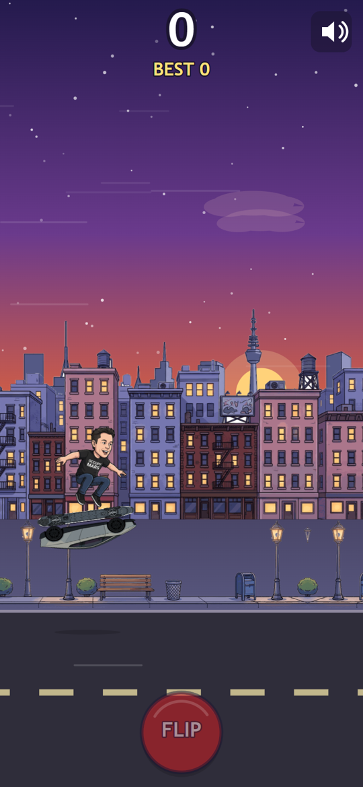
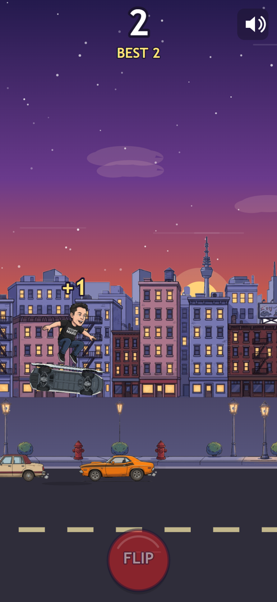
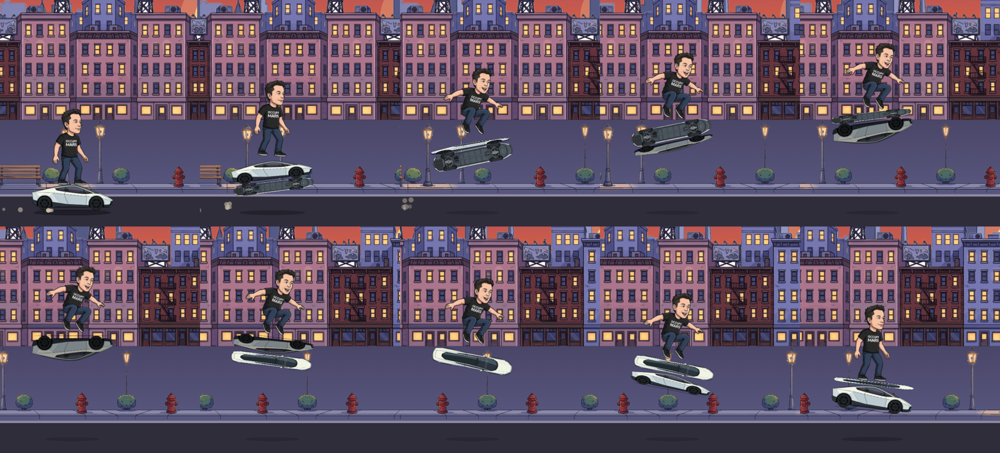

# Tesla Flip 🛹⚡

Tiny mobile-first browser game: a cartoon Elon rides a miniature Tesla Roadster like a skateboard through a dusk city while old V8 gas guzzlers block the road. Tap to kickflip over them. Crash = game over.

- Play: https://klaymendel-art.github.io/tesla-flip/
- Stack: vanilla HTML5 Canvas 2D, no frameworks, no build step.
- Art generated via OpenRouter (Gemini image models), audio synthesised procedurally with Python/numpy.


## Screenshots

| Title | Kickflip | Double flip over a pair |
|---|---|---|
|  |  |  |



## How it was made

Built in one session by a producer session coordinating five agents (dev, art, SFX, music, QA). The QA agent ran three review rounds with pixel and timing measurements — see `qa/REPORT.md`. Art via OpenRouter image models (≈ $1 total), audio synthesised with numpy; everything is re-renderable from `tools/`.

## Controls

| Input | Action |
|---|---|
| Tap / click anywhere (or the big FLIP button) | Kickflip |
| Two taps within 200 ms | Double flip — higher and longer, clears a close pair of cars |
| `Space` / `↑` / `Enter` | Kickflip (desktop) |
| `M` or the speaker icon (top-right) | Mute / unmute (remembered) |
| Tap on the GAME OVER panel | Retry |

+1 point for every car you clear. Speed ramps up with your score; the best score is kept in `localStorage`.

## Run locally

Audio is fetched via `fetch()`, so the game needs an HTTP server (from `file://` it runs silently):

```sh
python -m http.server 8077      # then open http://localhost:8077/
```

Append `?debug=1` to the URL to draw the collision boxes. `window.TF` exposes the game state for automated testing.

## Project layout

- `index.html`, `src/game.js`, `src/audio.js`, `src/style.css` — the game.
- `assets/img`, `assets/sfx`, `assets/music` — art and audio (see `docs/DESIGN.md` for the asset contract).
- `tools/` — generators (`gen_image.py`, `placeholders.py`, audio scripts).
- `qa/` — QA report and screenshots.

## Note

The rider is a caricature made for parody. This project is a fan-made toy with no affiliation with, or endorsement by, Tesla, Inc. or any person depicted.
